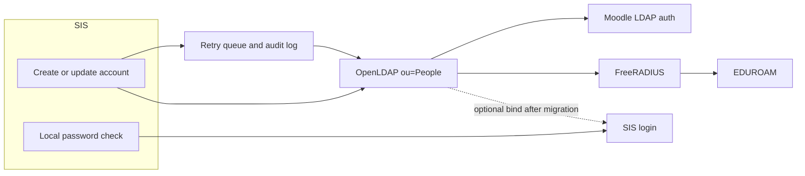

# SLGTI centralized LDAP identity

SIS stays the system that registers students and staff. LDAP is the directory LMS and EDUROAM authenticate against. This SIS copy already provisioned `ou=People,dc=slgti,dc=ac,dc=lk`. The work in this tree extends that path. It does not replace SIS, Moodle, or the directory.



## What was already in place

- Domain `slgti.ac.lk`, people container `ou=People,dc=slgti,dc=ac,dc=lk`.
- SIS database `sisslgti`. Login passwords are SHA-256 hex or `password_hash` in `user.user_password_hash`.
- `helpers/SisLdap.php` creates `inetOrgPerson` entries and stores `{SSHA}` passwords. It does not copy a SHA-256 hash into LDAP, because a bind cannot use that hash.
- New students are provisioned from admission registration. New staff receive the staff default password in SIS and in LDAP. Password changes in SIS update LDAP. A failed LDAP write does not roll back the SIS save.
- The admin page is **EDUROAM LDAP** under Administration.
- Moodle is `https://lms.slgti.ac.lk`. The IAM host in the server list is `lam.slgti.ac.lk`.
- From this workstation, TCP 389 was closed on `127.0.0.1`, `172.16.1.230`, `172.16.1.240`, `172.16.1.245`, `lms.slgti.ac.lk` and `lam.slgti.ac.lk`. There is no `.env` here, so the LDAP bind account is not configured on this copy. Moodle and FreeRADIUS were not changed.

## What this change adds

- `ldap_sync_queue` and `ldap_sync_log`. New tables only. No existing table, row, or primary key is altered.
- A password that cannot be written to LDAP is encrypted in the queue and retried by `scripts/ldap_sync_missing.php`. The log never stores the password.
- Disabling a student (`student_status` no longer Active) sets the LDAP entry `businessCategory=disabled` and attempts the password-policy lock `pwdAccountLockedTime`. The entry is not deleted.
- Reactivating clears that marker and the policy lock.
- Staff employment status `Working` or `Active` keeps the LDAP entry usable. `Terminated`, `Resigned`, `Retired`, `Inactive`, `Left` disables it. SIS `user_active` for staff is left as it already was.
- Name, department and student/staff type can be copied onto an existing entry. `userPassword` is replaced only when SIS itself has a new password.
- A staff ID rename does not delete or rename the LDAP entry. The admin log asks for a review.
- SIS login is unchanged while `LDAP_SIS_AUTH=local`.

## Password and EDUROAM method

`{SSHA}` is verified by an LDAP bind. That works for SIS, Moodle, and FreeRADIUS **EAP-TTLS with inner PAP**.

PEAP-MSCHAPv2 cannot use `{SSHA}`. It needs an NT hash, which is not stored here. Do not switch EDUROAM to PEAP-MSCHAPv2 unless a separate compatible credential store is designed. Keep the working EAP method until that design is tested.

Disabled accounts are blocked in SIS by `user_active`. Wi-Fi and Moodle block them only after the directory and those services honor `businessCategory=disabled` or `pwdAccountLockedTime`. The password-policy lock works when the OpenLDAP ppolicy overlay is enabled. The FreeRADIUS user filter below is the backup when it is not.

## Moodle

Apply this on the LMS host after a backup of `mdl_config_plugins` for `auth_ldap` and a username match. Do not create a second Moodle user.

| Setting | Value |
| --- | --- |
| Authentication | LDAP server |
| Host URL | `ldap://ldap.slgti.ac.lk:389` with StartTLS, or `ldaps://ldap.slgti.ac.lk` |
| Contexts | `ou=People,dc=slgti,dc=ac,dc=lk` |
| User attribute | `uid` |
| Bind | The same limited service account SIS uses, not `cn=admin` |
| Password type | Plain so Moodle binds to LDAP. Moodle does not store that password when "Prevent local passwords" is on |
| Create users | On first successful login only |
| Existing users | Where `mdl_user.username` equals the SIS username and `deleted=0`, set `auth` from `manual` to `ldap`. Do this only for rows the dry-run matched |

Match report before the auth change:

```sql
-- Run on Moodle. Compare the username list with storage/ldap-reports/latest.txt.
SELECT username, auth, suspended, deleted
FROM mdl_user
WHERE deleted = 0 AND auth <> 'ldap';
```

If two Moodle rows share one username, stop and merge them by hand. Courses, enrolments and grades stay on the existing user id.

## FreeRADIUS

On `lam.slgti.ac.lk`, back up `/etc/freeradius` or `/etc/raddb` before editing. Keep VLAN and reply attributes as they are.

Use the LDAP module with a bind, not a clear-text password compare:

- `server = ldap.slgti.ac.lk`
- `base_dn = ou=People,dc=slgti,dc=ac,dc=lk`
- `identity` / `password` = the limited SIS bind account
- StartTLS on
- `user_filter` includes the disable marker, for example `(&(uid=%{User-Name})(!(businessCategory=disabled)))`
- EAP: leave the current outer method. Inner authentication for `{SSHA}` is PAP inside EAP-TTLS.

Confirm with a test account: `radtest` PAP against the directory, then a disabled account must be rejected. Do this before changing the live SSID.

## SIS settings

Copy these into the server `.env`. Leave `LDAP_SIS_AUTH=local` until the test list below passes.

```
LDAP_SYNC_ENABLED=1
LDAP_HOST=ldap.slgti.ac.lk
LDAP_PORT=389
LDAP_STARTTLS=1
LDAP_BIND_DN=cn=sis-sync,dc=slgti,dc=ac,dc=lk
LDAP_BIND_PASSWORD=
LDAP_PEOPLE_DN=ou=People,dc=slgti,dc=ac,dc=lk
LDAP_BASE_DN=dc=slgti,dc=ac,dc=lk
LDAP_TLS_CA=
LDAP_SIS_AUTH=local
```

`LDAP_SIS_AUTH` values:

- `local` — current SIS password check only.
- `ldap_or_local` — SIS accepts the local password or a successful LDAP bind. Use this after passwords have been synced, so nobody is locked out.
- `ldap_primary` — if LDAP contains the user and refuses the password, SIS refuses it too. If LDAP is down or the user is absent, SIS uses the local password.

The bind account should be allowed to search and write `ou=People` only. It should not be `cn=admin`.

## Migration

```
php scripts/ldap_migration_report.php
```

The script refuses `--apply`. It writes `storage/ldap-reports/latest.txt` with SIS totals, LDAP matches, missing active accounts, duplicate usernames, entries with no password yet, disabled markers, and LDAP entries that are not in SIS. It does not overwrite passwords.

The admin page **Dry-run report** runs the same comparison. **Sync missing accounts** creates entries that are absent and does not replace an existing password. **Sync account status** only changes the active/disabled marker. **Sync names** updates name, department and type.

## Backup and rollback

Taken before the new tables were created:

- `storage/backups/sisslgti-20261127-143557.sql` (dump completed, contains `user`)

Rollback of this SIS change:

1. Set `LDAP_SYNC_ENABLED=0` and `LDAP_SIS_AUTH=local` in `.env`.
2. Restore the previous copies of `helpers/SisLdap.php`, `controllers/AuthController.php`, `controllers/AdminController.php`, `controllers/StaffController.php`, `models/StudentModel.php` and `views/admin/ldap-sync.php` if the new sync must be removed.
3. The new tables can be left in place. They contain no SIS profile columns. Drop them only if you explicitly decide to remove the audit log: `DROP TABLE ldap_sync_queue, ldap_sync_log;`
4. Restore `sisslgti` from the dump only if a later change damages existing rows. Restoring the dump also removes every SIS change made after 14:35 on 27 Nov 2026.
5. On Moodle, set `mdl_user.auth` back to the previous value and disable the LDAP plugin. On FreeRADIUS, restore the backed-up `mods-enabled/ldap` and `mods-enabled/eap`.

## Tests still required on the live network

Use one new student and one new staff account. Do not use a production password in a ticket or log.

1. Create the student in SIS. Confirm an LDAP entry `uid=<username>,ou=People,dc=slgti,dc=ac,dc=lk` with `employeeType=student` and `businessCategory=active`.
2. Sign in to SIS. With `LDAP_SIS_AUTH=local`, this uses the SIS password.
3. Sign in to Moodle with the same username and password after the LMS plugin is pointed at this directory.
4. Join EDUROAM with EAP-TTLS/PAP.
5. Change the password in SIS. The old password must fail and the new one must work on each service that is already connected.
6. Set the student inactive. SIS login stops. LDAP shows `businessCategory=disabled`. LMS and Wi-Fi stop after their filters are in place.
7. Reactivate and confirm the marker returns to `active`.
8. Create a staff account and repeat sign-in, disable and enable.
9. Run the dry-run twice. The second run must not create a duplicate `uid`.
10. Stop the directory or set a wrong host. Saving the SIS user must still succeed, and the admin page must show a pending retry. Start the directory and run **Retry queue**.

## Production order

1. Put the real bind account in the SIS server `.env` and keep `LDAP_SIS_AUTH=local`.
2. Run the dry-run on the SIS server. Review duplicates and missing accounts.
3. Back up Moodle auth config, FreeRADIUS, and an LDIF of `ou=People`.
4. Sync missing accounts. Do not bulk-reset passwords.
5. Point Moodle at LDAP only after username matches are reviewed.
6. Add the FreeRADIUS filter beside the existing EAP setup and test one client before the campus SSID uses it.
7. Move `LDAP_SIS_AUTH` to `ldap_or_local` only after a test account works on SIS, Moodle and EDUROAM.
8. Rotate the server administrator passwords that were included in the infrastructure screenshot. They are not stored in this application.
